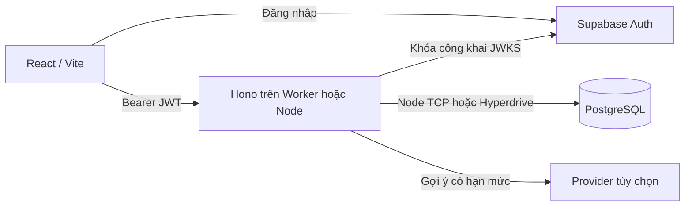

# Kiến trúc

HashRouter hỗ trợ deep link trên GitHub Pages project site. API dùng Hono chung cho hai runtime. Node giữ pool theo tiến trình. Worker dùng kết nối theo request và đóng trong waitUntil. Truy vấn danh mục dùng Drizzle SQL builder. Giao dịch chấm điểm và xuất bản dùng Postgres.js.

Hàm tạo ứng dụng nhận database, bộ xác minh danh tính, origin web và provider AI. Mỗi request cá nhân được xác thực, tra vai trò tại database rồi giới hạn tài nguyên theo chủ sở hữu. Các test chỉ thay provider danh tính hoặc AI tại ranh giới này. Bộ browser test dùng chữ ký JWT và quá trình tải JWKS thực qua loopback.
